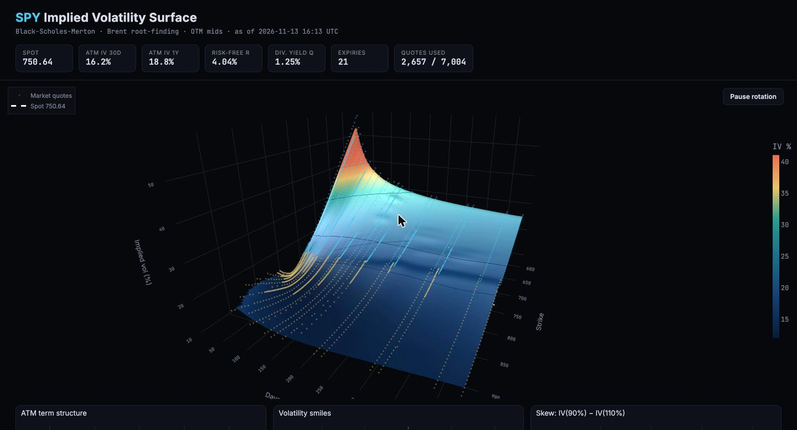

# Implied Volatility Surface

A rotating 3D implied-volatility surface, built from live option chains and drawn on a dark, trading-desk-style dashboard.

**🌐 Live website: https://ianjacobo2009-hub.github.io/iv-surface/** (SPY, QQQ, AAPL, NVDA and TSLA, rebuilt every weekday after the US close)

**💻 Desktop app (any ticker):** download it from [Releases](https://github.com/ianjacobo2009-hub/iv-surface/releases/latest)
- **Mac:** `IVSurface-macOS.zip`. Unzip it, then right-click → Open the first time, because the app is unsigned.
- **Windows:** `IVSurface-Windows.zip`. Unzip it and run `IV Surface.exe`.



## What it does
1. **Downloads every option chain** for a ticker with `yfinance`: 10 days to about 18 months, strikes 75–125% of spot.
2. **Keeps clean quotes only:**
   - out-of-the-money puts below spot and calls above it
   - bid > 0
   - spread under 35% of mid
   - some open interest or volume
3. **Backs out implied volatility** for every quote: the σ that makes the Black-Scholes-Merton price equal the mid price, solved with `scipy.optimize.brentq` on [0.01%, 500%]. Quotes outside the no-arbitrage bounds are dropped.
4. **Builds the surface:**
   - interpolation in (log-moneyness, √T), where smiles are nearly straight
   - a light Gaussian blur that ignores empty cells
   - no extrapolation outside the quoted region
5. **Draws the dashboard:**
   - the auto-rotating 3D surface with every market quote shown as a dot
   - ATM term structure, volatility smiles and skew (IV at 90% minus IV at 110% of spot)

**Inputs:**
- spot from Yahoo
- risk-free rate r from the 13-week T-bill (`^IRX`)
- dividend yield q from trailing 12-month dividends

## The math
- d₁ = [ln(S/K) + (r − q + σ²/2)T] / (σ√T)
- d₂ = d₁ − σ√T
- C = S·e^(−qT)·N(d₁) − K·e^(−rT)·N(d₂)
- P = K·e^(−rT)·N(−d₂) − S·e^(−qT)·N(−d₁)

The price rises steadily with σ (vega > 0), so each quote has exactly one implied vol, and Brent's method finds it inside the bracket.

## Three ways to use it
| | What | How |
|---|---|---|
| Website | 5 tickers, updated daily | open the link above |
| Desktop app | any ticker, built in the window | download from Releases, or `python run_ivsurface.py` |
| Command line | any ticker, saves an HTML file | `python -m ivsurface SPY --open` |

The website is built by `tools/build_site.py` and deployed by the `website` GitHub Action (`.github/workflows/pages.yml`). If Yahoo refuses a download, the site falls back to the snapshots saved in `samples/`.

## Run from source
```bash
python3 -m venv .venv && source .venv/bin/activate
pip install -r requirements.txt
python -m ivsurface SPY --open        # any ticker: QQQ, AAPL, NVDA, TSLA…
python -m ivsurface --from-csv data/SPY_<stamp>_iv.csv   # re-draw a saved snapshot offline
python run_ivsurface.py               # desktop app
python tools/build_site.py --offline  # website from saved snapshots, written to site/
python -m pytest -q
```
In VS Code use **Run and Debug**:
- **SPY surface (live) + open**
- **Any ticker (live) + open**
- **Tests**

The tests check:
- Hull's Example 15.6 (call 4.76, put 0.81)
- put-call parity with dividends
- the implied vol round trip at 4 vol levels and 3 strikes
- that arbitrage quotes are rejected
- that the grid rebuilds a flat surface exactly
- that the website builds offline from the snapshots

## Notes
Yahoo data is delayed and sometimes stale outside market hours. The tool is for study, not trading.

**Reference:** J. Hull, *Options, Futures, and Other Derivatives*: ch. 15 (Black-Scholes-Merton), ch. 17 (options on indices and dividend-paying stocks) and ch. 20 (volatility smiles and surfaces). The QuantPy YouTube channel has walkthroughs of volatility surfaces.

---
Personal project by Ian.
